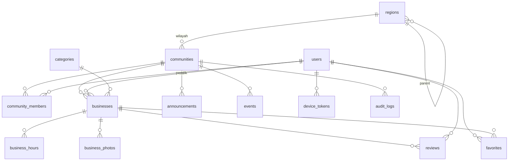

# Rancangan Database

## Keputusan

| Aspek | Pilihan | Alasan |
|---|---|---|
| Mesin | **PostgreSQL 15+** | Matang, andal, mendukung JSONB, indeks canggih, dan ekosistem hosting luas |
| Geospasial | **PostGIS** | Pencarian "usaha terdekat" dan batas wilayah lingkungan |
| Pencarian teks | `pg_trgm` (awal) | Cukup untuk ribuan usaha; bisa diganti Meilisearch/Typesense saat besar |
| Primary key | **UUID** | Aman dibuka di URL/API, mudah digabung antar-lingkungan, tidak bisa ditebak |
| Multi-tenant | **Satu skema, kolom `community_id`** | Paling hemat biaya dan mudah dipelihara; bisa diperkuat dengan Row Level Security |
| Hapus data | **Soft delete** (`deleted_at`) | Aman dipulihkan, cocok untuk audit |
| File/foto | **Object storage** (S3-compatible) | Database hanya menyimpan URL |

## Mengapa ini bisa tumbuh sampai skala nasional

1. **Hierarki wilayah** (`regions`): provinsi → kabupaten/kota → kecamatan → kelurahan/desa → RW → RT. Lingkungan baru tinggal ditautkan ke wilayahnya, sehingga laporan dan pencarian bisa digulung per kota, provinsi, atau nasional.
2. **Akun global, keanggotaan per lingkungan** (`users` + `community_members`): satu orang bisa menjadi warga di satu lingkungan dan penjual di lingkungan lain.
3. **Kategori global** (`categories`): satu katalog kategori untuk semua lingkungan, jadi statistik lintas lingkungan konsisten.
4. **Indeks sejak awal**: kombinasi `community_id` + status/waktu, indeks spasial (GiST), dan trigram untuk pencarian nama.
5. **Jalur peningkatan** saat data membesar:
   - Aktifkan **Row Level Security** agar isolasi antar-lingkungan dijaga oleh database, bukan hanya kode aplikasi.
   - **Partisi** `audit_logs` per bulan.
   - **Read replica** untuk beban baca (portal publik) dan **cache** (Redis/CDN) untuk halaman yang jarang berubah.
   - Pindahkan pencarian ke mesin khusus bila pencarian teks mulai berat.

## ERD

## Hosting database (terpisah dari web)

Web berjalan di Vercel, database di layanan Postgres terkelola yang punya paket gratis, misalnya **Neon** atau **Supabase**. Keduanya umumnya mendukung ekstensi PostGIS. Beberapa catatan:

- Pakai connection string versi **pooled** bila tersedia (cocok untuk fungsi serverless Vercel). `src/lib/db.ts` sudah memakai `prepare: false` agar kompatibel dengan pooler.
- Jalankan migrasi dari komputer Anda: `npm run db:migrate` dengan `DATABASE_URL` database tujuan. Jangan dijalankan otomatis saat build.
- Paket gratis punya batas penyimpanan dan bisa "tidur" saat sepi. Cek ketentuan terbaru masing-masing layanan.
- Karena hanya memakai SQL standar Postgres, database bisa dipindah ke penyedia lain tanpa mengubah kode.

## Aturan penting

- Tabel yang punya `community_id` **wajib** difilter per lingkungan di setiap query.
- Perubahan skema **hanya lewat migrasi baru** di `db/migrations/`, berurutan (`0002_...`, `0003_...`). Jangan mengubah migrasi yang sudah dijalankan.
- `rating_avg` dan `rating_count` pada `businesses` adalah kolom turunan; perbarui saat ulasan dibuat, diubah, atau dihapus.
- OTP dan sesi login ditangani penyedia autentikasi (mis. Supabase/Firebase) sehingga tidak ada tabel OTP di sini.
- `npm run db:migrate` mencatat migrasi yang sudah berjalan di tabel `schema_migrations` dan menerapkan file baru secara berurutan dalam satu transaksi per file.

## Riwayat migrasi

| Migrasi | Isi |
|---|---|
| `0001_init.sql` | Skema awal |
| `0002_admin_auth.sql` | `users.password_hash` (format `scrypt$salt$hash`) untuk login admin email + sandi |
| `0003_reports.sql` | Tabel `reports` (laporan warga) dan tipe `report_status`; `ip_hash` hanya untuk pembatasan spam |
| `0004_reports_public.sql` | `reports.is_public` (moderasi tampil publik, bawaan `false`) |
| `0005_app_releases.sql` | Tabel `app_releases` dan tipe `app_platform` (rilis aplikasi mobile; global, tanpa `community_id`) |
| `0006_residents.sql` | `invite_codes` (kode undangan), `residents` (profil warga per lingkungan, persetujuan data), `auth_attempts` (pembatasan percobaan login; hanya hash) |
